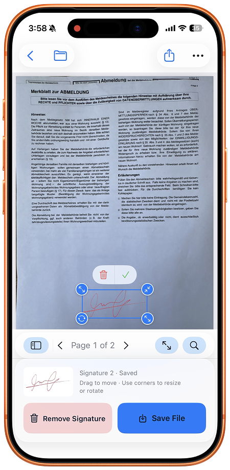

Après une erreur découverte dans un PDF aplati exporté de SignDocs, ouvrez l’original inchangé depuis Fichiers et remplissez-le de nouveau. Enregistrez une nouvelle copie et vérifiez-la. Rouvrir le résultat dans Recent Docs permet de le consulter, mais ne rétablit pas ses anciens champs et ne retire pas les réponses intégrées à la page.

## Retrouver la bonne source

Gardez le résultat incorrect pour comparer les réponses, sans le reprendre comme document de départ. Dans l’original, examinez précisément la page concernée. Le mot « original » dans le nom ne suffit pas : la mauvaise réponse doit être absente. Si elle fait déjà partie du texte imprimé, demandez une source vierge à l’expéditeur. La recouvrir avec une autre réponse laisserait l’ancien contenu en dessous.

Pour une modification encore en cours dans la session, annuler ou rétablir peut aider. Cela ne permet pas de revenir sur une exportation déjà aplatie.

## Préparer la copie de remplacement

1. Notez la page, la question et la réponse correcte à partir du mauvais résultat. Relevez aussi les autres réponses à saisir de nouveau.
2. Téléchargez la source si elle est uniquement dans le cloud. Ouvrez-la depuis Fichiers dans SignDocs et contrôlez le nombre de pages.
3. Complétez de nouveau les champs compatibles. Sur une source plate ou scannée, placez du texte multiligne et des coches dans les espaces vides, puis vérifiez leur ajustement. Le [guide des formulaires](/fr/blog/fill-pdf-form-iphone/) distingue ces cas.
4. Choisissez de nouveau votre écriture si une signature est nécessaire. Comparez dates et signatures avec les nouvelles réponses.
5. Enregistrez une copie distincte portant un nom reconnaissable pour cette révision, puis ouvrez-la dans Recent Docs.
6. Vérifiez la correction et toutes les autres pages. Au partage, choisissez ce fichier contrôlé et ouvrez la véritable pièce jointe avant l’envoi.

## Exemple : changer de créneau

Une inscription à un atelier exportée indique le matin, alors que vous souhaitez l’après-midi. Notez la correction, repartez du formulaire vierge et ressaisissez toutes les réponses nécessaires. Dans le nouveau résultat, vérifiez que seul le bon créneau est sélectionné, puis relisez le nom et la signature. Contrôler seulement la case modifiée peut faire manquer une réponse oubliée pendant la reprise.

Si l’ancienne copie est déjà partie, un nouvel enregistrement ne remplace pas la pièce jointe reçue. Indiquez au destinataire quel fichier révisé utiliser par votre canal habituel. Le [guide de partage](/fr/blog/save-share-signed-pdf-iphone/) aide à contrôler le nouvel envoi.

## Autre option et limites

[Aperçu sur iOS 26](https://support.apple.com/guide/iphone/fill-out-and-sign-pdf-forms-iphd7e3c0c74/26/ios/26) peut remplir et signer une source propre : ouvrez le PDF, choisissez le remplissage, sélectionnez un champ et saisissez la réponse. Une nouvelle installation est facultative. SignDocs est utile pour associer ces documents à une écriture capturée sur papier.

SignDocs nécessite iOS/iPadOS 26 ou ultérieur. Les exports gratuits sont limités, y compris les copies de remplacement. Le traitement reste sur l’appareil sans compte ni téléversement pour traitement. Installation, achats/restaurations, récupération cloud et partage externe ont leurs propres besoins de connexion. Cette méthode reprend la source ; elle ne modifie pas le texte existant d’une sortie aplatie.

[Source produit : Signature Scan: Sign PDFs — App Store](https://apps.apple.com/us/app/signature-scan-sign-pdfs/id6805875185)
