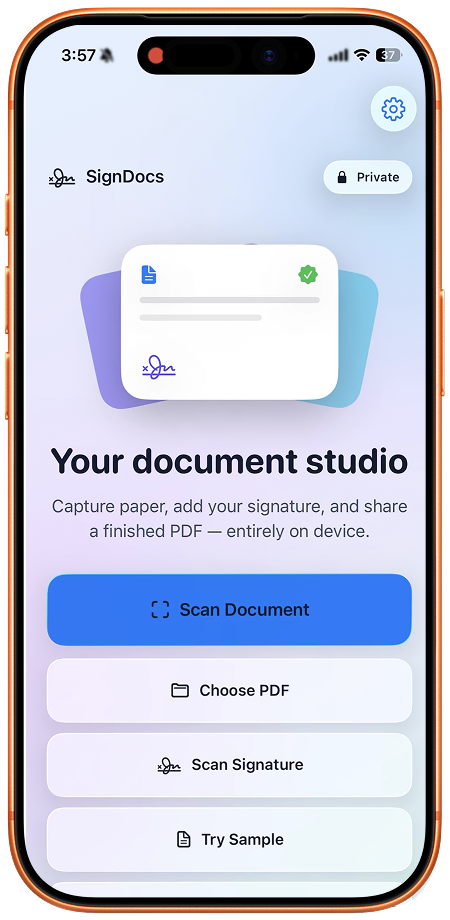

Скан остаётся в приложении и в месте, которые использовались при его создании. В «Заметках» ищите заметку с вложением, в «Файлах» — выбранную при сохранении папку, а в SignDocs — Recent Docs. Общей папки iPhone, куда автоматически попадают сканы из всех приложений, нет.

## Начните с исходного приложения

Вспомните, что вы открывали перед съёмкой: заметку, папку в «Файлах» или SignDocs. Сохранённый внутри приложения документ не обязательно автоматически экспортируется в «Файлы».

Например, двухстраничный список оборудования, отсканированный в заметке о встрече, остаётся её вложением. Поиск имени PDF в «Файлах» не поможет, если отдельную копию туда не сохраняли. Сначала проверьте заметку, прежде чем заново снимать тот же бумажный документ.

## Найдите вложение в «Заметках»

1. Введите в поиске «Заметок» запомнившийся заголовок или подходящие слова.
2. Откройте возможные заметки и проверьте вложения. Скан находится в заметке, выбранной или созданной до съёмки.
3. Если заметку не помните, откройте дополнительные действия в списке заметок и просмотр вложений. В источнике Apple эти действия названы More и View Attachments.
4. Нажмите и удерживайте подходящую миниатюру, затем выберите Show in Note, чтобы перейти к содержащей её заметке.
5. Откройте скан и проверьте первую страницу и общее количество страниц.

Это названия из [инструкции Apple по вложениям](https://support.apple.com/en-euro/118442), а не кнопки SignDocs. Для заблокированной заметки поиск показывает только заголовок. Отсутствие результата по содержимому ещё не означает, что скан исчез.

## Проверьте папку в «Файлах»

Откройте место и папку, выбранные при сохранении. Недавние файлы — это недавно открытые документы, а не полный архив сканов. Ищите по имени файла, папки или типу документа. Проверьте область поиска: поиск только среди недавних или в одном месте может пропустить другой каталог. [Руководство «Файлов» для iOS 26](https://support.apple.com/guide/iphone/find-and-view-files-and-folders-iphe4bff8827/26/ios/26) объясняет эти области.

## Сверьте найденную копию

В SignDocs откройте сохранённый PDF через Recent Docs. Если экспортировали копию в «Файлы», проверьте и выбранную папку назначения. Прочитайте название на самой странице и сравните число страниц с оригиналом. Похожее имя может принадлежать другому черновику или неподписанной версии.

Для списка из двух страниц проверьте последний пункт второй страницы, а не только обложку. Отделите неподписанный оригинал от подписанной копии. [Руководство по сохранению и отправке](/ru/blog/save-share-signed-pdf-iphone/) поможет проверить именно тот файл, который станет вложением. Облачный файл загрузите при наличии связи до работы без интернета.

Для поиска готового скана устанавливать SignDocs не требуется. [Встроенных сканеров Apple](https://support.apple.com/en-us/108963) может быть достаточно. SignDocs полезен, когда нужно снять бумагу, захватить рукописную подпись и создать отдельную подписанную копию PDF. [Многостраничное сканирование](/ru/blog/scan-multiple-pages-one-pdf-iphone/) описывает создание нового файла. Приложение не импортирует библиотеку «Заметок» и не восстанавливает удалённые документы.

SignDocs требует iOS/iPadOS 26 или новее. Бесплатный экспорт ограничен. Обработка выполняется на устройстве без аккаунта и загрузки для обработки. Установка, покупки и восстановление, получение облачных файлов и внешняя отправка имеют отдельные требования к соединению. Возможности поиска «Заметок» не означают распознавание текста или поиск содержимого в SignDocs.
